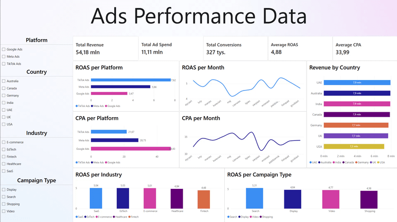

# Global Ads Performance Analysis (Portfolio Project)

## Project Overview
This is an end-to-end data analysis project focusing on digital advertising metrics. The primary objective was to demonstrate the full data lifecycle: from importing raw CSV data into a SQL database and performing Exploratory Data Analysis (EDA) to building an interactive visualization dashboard in Power BI.

The dataset contains synthesized advertising performance metrics (Impressions, Clicks, Spend, Revenue, Conversions) across major platforms (Google Ads, Meta Ads, TikTok Ads) and various campaign types.

## Key Business Insights (EDA Findings)
Based on the SQL exploratory data analysis, the following key trends were identified:
* **Top Platform:** TikTok Ads generated the highest overall ROAS and lowest CPA.
* **Best Performing Segment:** Within TikTok, the E-commerce industry was the most profitable.
* **Optimal Campaign Type:** Search campaigns within TikTok E-commerce achieved a peak **10.7 ROAS** while maintaining the second-best CPA.
* **Seasonality:** November proved to be the most cost-effective month, delivering the highest ROAS and lowest CPA for the TikTok E-commerce segment.

## Tools & Technologies Used
* **SQL (MySQL):** Used for initial data validation, data type formatting, and calculating KPIs directly within the database engine (CPA, ROAS).
* **Power BI:** Used for data ingestion (flat file), building interactive visualizations, formatting custom visuals (dual charts, KPIs), and implementing cross-filtering functionality.
* **DAX:** Used for writing custom calculation measures.

## Repository Structure
* `data_cleaning_and_staging.sql`: SQL scripts ensuring data standardization and date formatting.
* `exploratory_data_analysis.sql`: Analytical queries used to test the data, calculate real ROAS/CPA, and prepare time-trend aggregations.
* `Marketing_Ads_Performance_Dashboard.pbix`: The source Power BI project file containing the data model, DAX measures, and dashboard layout.
* `dashboard_main.png`: A static screenshot of the final dashboard.
* `dashboard_demo.gif`: A brief screen recording showing the interactive filtering capabilities of the Power BI report.

## Dashboard Preview

**Data Source:** The dataset used for this project was sourced from [Kaggle (Global Ads Performance)](https://www.kaggle.com/datasets/nudratabbas/global-ads-performance-google-meta-tiktok).
